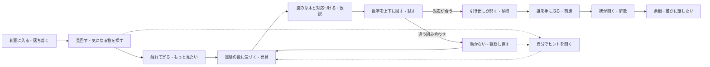
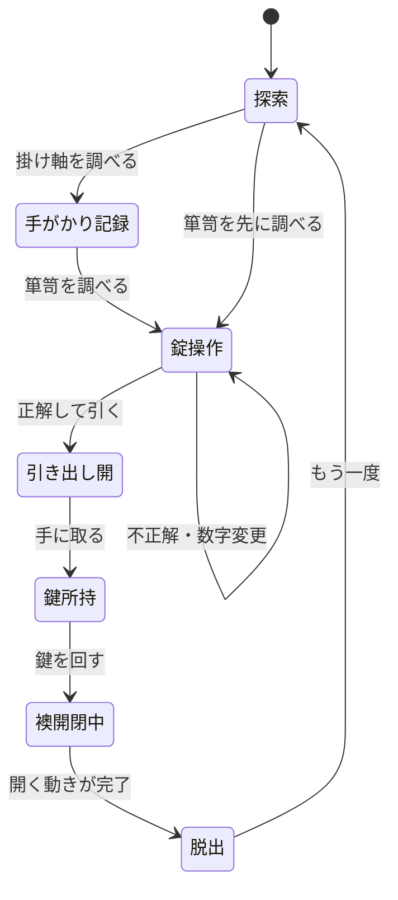

# ES図 — 行動・発見・感情

この計画の「ES図」は、プレイヤーの行動・発見・感情を重ねる体験設計図として暫定的に扱う。業界共通の用語と断定しない。感情は設計意図であり、実測結果ではない。

| 場面 | 美術の必要性 | 観察で確かめること |
|---|---|---|
| 全景 | 畳・障子・床の間で向きと注目箇所をつくる | 説明なしで最初の調査へ進めるか |
| 掛け軸 | 松竹梅の墨絵が数の手がかりを担う | 草木の種類と数を読み取れるか |
| 箪笥 | 木の錠、刻印、引き手で操作を示す | 上下・タップ・引く操作が分かるか |
| 正解 | 引き出しと音の変化が因果を返す | 正解した理由と結果が伝わるか |
| 不反応 | 和紙の短い墨書きで応答する | 操作失敗と無反応な物を区別できるか |
| 脱出 | 襖の開閉と光で終わりを示す | 達成と余韻を感じるか |

## 実装上の状態

ヒントは進行状態を勝手に変更しない。閉じる・拡大・見回す操作でも手がかりや数字を失わない。既存の進行保存を引き継ぐ。
