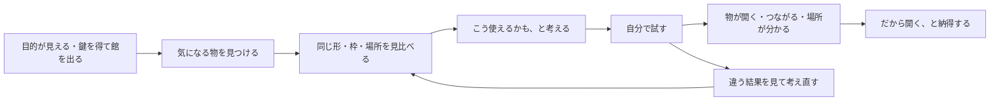
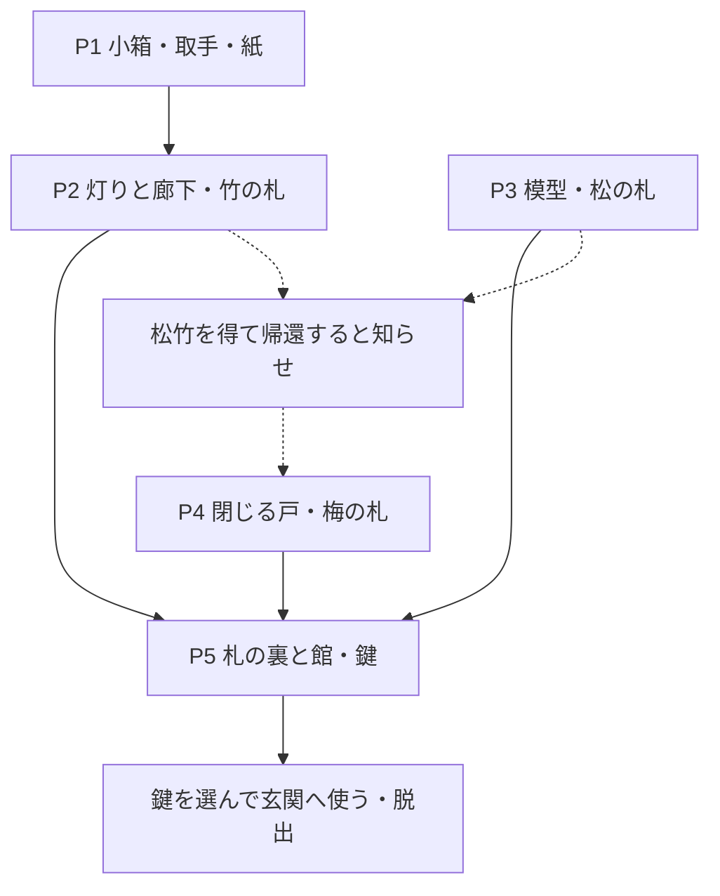

# ES図R2 — 気づく根拠と、試した結果

2026-10-22。次期版の体験設計。新しい操作・五問は未実装。感情は設計意図であり、実測結果ではない。[拡大できる図](../project.html)と[各問の詳細](REDESIGN-R2.md)を参照。

| 場面 | 根拠として見える物 | 確認したい理解 |
|---|---|---|
| P1 小箱 | 同じ三分割の枠と隅印、取手と穴の同形 | 配置の対応と道具使用を理解できる |
| P2 紙と灯り | 紙の薄さ、枠の切り欠き、図と廊下の同じ柱 | 紙を透かして実物の場所へ結びつけられる |
| P3 模型 | 上面の線、見本、回転軸、固定具 | 上から見て組み替える理由を理解できる |
| P4 知らせ | 紙の厚み、端の墨、裏の鶴と実物の戸 | 通知を立体物として扱い、閉じる行動へ応用できる |
| P5 紋札 | 裏の地図、同じ柱と玄関、外形の継ぎ目 | 歩いた館と集めた物の関係に気づく |

## 必要な物と、演出の出現条件を分ける

破線は知らせを出す条件であり、梅の札を取るための読了条件ではない。先に戸を閉めても成功。先に模型を解く行動も受け入れる。合理的な先回りを拒否して作者の順序へ戻さない。

## 操作と推理の障害を分ける

近接・戻る・選択・使用を先に操作見本で確認する。謎で詰まったときに、証拠を見ていないのか、関係を推理できないのか、押したのに反応しないのかを[試遊記録](PLAYTEST.md)で区別する。
