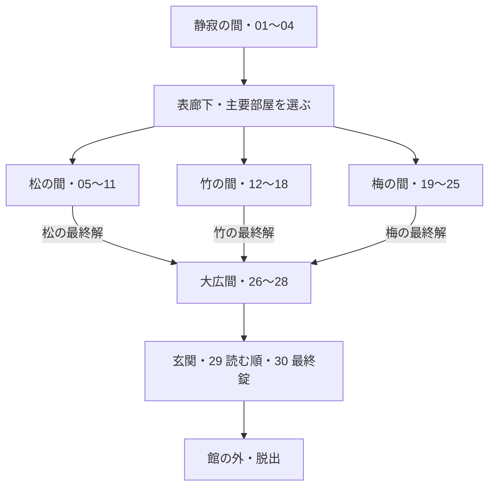

# 館からの脱出 — 部屋を巡り、松竹梅を最後に揃える

2026-10-22 改訂。**最終目標は館の外へ出ること。** v1.4.0では[静寂の間・表廊下・書院](WING.md)を行き来する最初の区画を実装。下記の三つの主要部屋と全30段階への拡張は未実装。

## 館の構成

三つの主要部屋からは廊下へ戻れる。図は進行関係であり、扉を閉めて順路を固定する意図ではない。各室で小謎を集約して別の仕掛けを開き、最後にその部屋の松・竹・梅の答えを得る。三つの答えを館の最終脱出へ集約する。

## 部屋全体を探索する

歩行視点では室内から360度見渡し、前後左右の壁・隅・家具の裏を調べる。神目線では外から回転し、手前の壁を隠して奥を見る。これは両方使える操作仕様であり、どちらか一つに固定しない。[操作仕様](CONTROLS.md)を参照。

正面に謎を詰め込まず、向きを変えると違う発見がある構成にする。後ろを見る必要を、光の向き、木目の連続、紙の切れ目などで伝える。正解を「反対を見て」の文章だけで教えない。光や模様が単なる装飾にならないよう、解法・方向の把握・反応のどれかに役割を与える。

## 最初の制作区画

「静寂の間＋表廊下＋主要部屋一つ」で、移動・帰還・一枝の推理・アイテム使用・途中保存を確認する。三つの答えは各主要部屋にあるため、初期の一部屋に館の全解答を掲載しない。v1.4.0では既存の手がかりを三か所へ再配置した。

## 軽量化と保存

輪郭・厚み・可動扉・引き出し・アイテムは3D。木目、和紙、細い装飾は縮小した共有画像で表現する。館の全室を同時描画せず、近い区画を先読みし、遠い部屋は必要時に読み込む。歩行には軽い当たり判定を用い、物理演算を追加しない。

館版の保存には形式の版、現在地、解いた謎ID、持ちもの、最終解の発見状態を記録する。現行の一部屋で脱出済みという情報を、館から脱出済みとみなさない。実機で移動時の通信、メモリ、フレーム間隔を測る。
