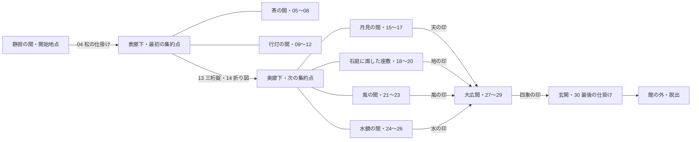

# 館からの脱出 — 空間を進行にする

2026-10-21 / 制作方針を更新。**最終目標は一部屋の脱出ではなく、館の外へ出ること。** 現行v1.1.0は、操作と見た目を確かめる一部屋の試作。以下の館・追加の謎は未実装。

## 館の構成

線は物理的な移動や進行の関係を表す設計案。部屋の寸法・実際の廊下の形はグレーボックス試作で決める。「茶の間」と「行灯の間」、奥の四部屋はそれぞれ順不同で探索できる。

## 30段階を置く場所

| 区間 | 謎の番号 | 役割・報酬 |
|---|---|---|
| 静寂の間 | 01〜04 | 向き・折り目・重なりを学ぶ。松の仕掛けを解き、松の答えと廊下への鍵を得る |
| 表廊下から茶の間 | 05〜08 | 竹の答えを得る。行灯の間と並行に進める |
| 表廊下から行灯の間 | 09〜12 | 梅の答えを得る。茶の間と並行に進める |
| 元の和室の箪笥・廊下の隠し襖 | 13〜14 | 三つの答えを箪笥へ集約。折り図と廊下の景色を照合すると奥廊下が開く |
| 奥廊下から四つの部屋 | 15〜26 | 各部屋で二つの情報を集め、一つの仕掛けを解く。天・地・風・水の印を得る |
| 大広間 | 27〜29 | 天地、風水、四象へ二段階で集約する |
| 玄関 | 30 | 最初に学んだ折り図の読み方と四象の関係を再利用して館の外へ出る |

移動、拾う動作、自動で開く扉を、新しい謎として水増ししない。13段階が一部屋に詰まる配置を避ける。元の和室へ戻る際は廊下から近道を用意し、同じ道の長い往復を要求しない。

## 感情の流れ

最初の襖が開く驚き → 廊下で選択肢が増える好奇心 → 別々の部屋の発見がつながる納得 → 奥廊下の空間変化 → 大広間で館全体の意味がつながる → 玄関から外の光へ。

全ての集約で数字錠を使わない。箪笥は数字、奥廊下は図と景色の重なり、大広間は印の位置関係、玄関はこれまでの読み方の応用にする。部屋ごとの美術を解法や観察に使い、単なる色違いの部屋にしない。

## 試作と軽さ

最初に制作する空間は「静寂の間＋表廊下＋隣室一つ」。入口、部屋の正面、元の場所への復帰、状態保存を通して確認してから館全体へ広げる。

3Dの部屋・自由な視点操作・扉の厚みと開閉は維持。共有する畳・木・和紙の画像は館全体で使い回す。隣接する場所を先読みし、遠い部屋は必要になるまで読み込まない。各室の3Dを同時に全部描画しない。現在の一部屋の比較機能を館全体の性能保証に流用せず、移動時の通信・メモリ・フレーム間隔を測る。

館版の保存は、保存形式の版、現在地、解いた謎ID、持ちもの、入力状態を記録する。現行版の「一部屋から脱出済み」を「館から脱出済み」とみなさない。途中で休んでも再開できることを完成条件に含める。
