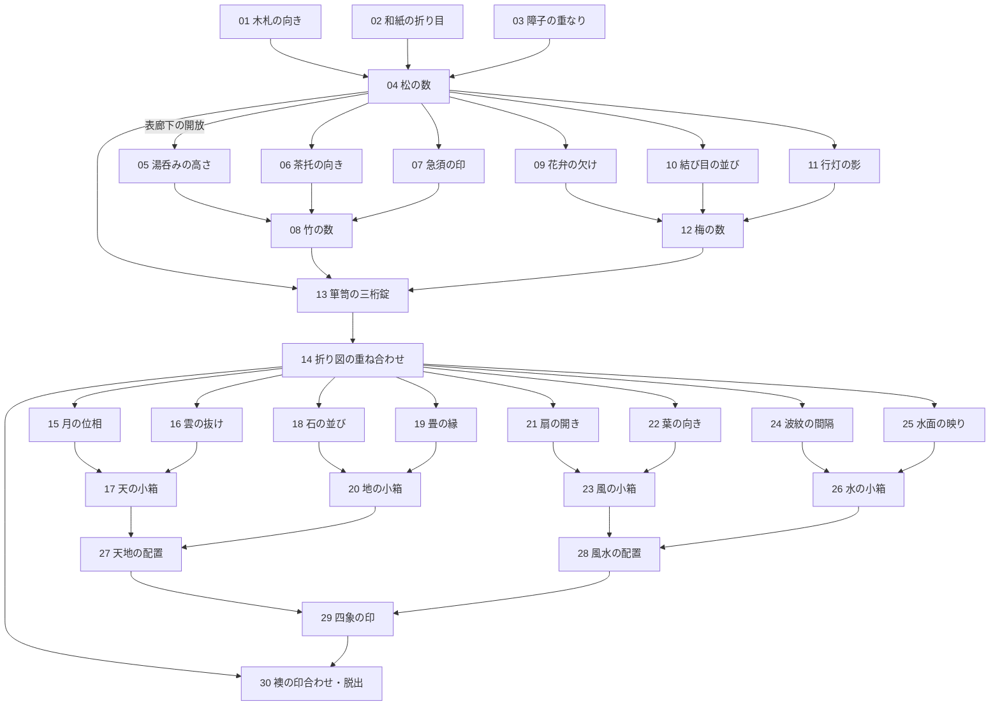

# 30段階の謎解き設計案

2026-10-21 / 制作候補。**現行v1.1.0には未実装**。現行の短い脱出経路と区別して、次の試作に使う。

30個すべてに新しいルールを覚えさせると、一部屋の密度と疲労が高くなる。中核13個と小さな推理17個の合計30段階とし、同じ草木・光・折り目の読み方を少しずつ応用する。単なる「拾う」「扉が自動で開く」は謎の数に含めない。

最終目標は**館からの脱出**。30段階を和室・廊下・隣室・大広間・玄関へ配置する。[空間と開放の構成](MANSION.md)を参照。

完成版の尺は**30〜45分を仮目標**に変更する。初見の試遊で調整する数字であり、30段階ならこの時間になると予測したものではない。短く遊びたい人のために各集約点で自動保存し、戻ったときは見つけた図を見返せるようにする。

ユーザー案の「9個の小謎→3個の答え→三桁錠」で13段階。次の一つに集約して14段階。そのあと「2個を解いて新しい1個」を一組足すと、数え方は17段階になる。30までの全体を下の依存図で揃える。

## 各段階に必要な推理

名前は制作仮題。数字を見つけただけの三回の入力にせず、見つけた情報をどう読むかを各集約点で考える。

| 番号 | 小謎・中核 | プレイヤーが行う推理 | 得られる情報・変化 |
|---|---|---|---|
| 01 | 小 | 木目と印の向きから木札を回す | 松の観察位置 |
| 02 | 小 | 折り跡が連続するよう和紙を折る | 松の輪郭の一部 |
| 03 | 小 | 障子二枚の抜けを重ねる | 松の輪郭の残り |
| 04 | 中核 | 三つの情報を観察位置で重ね、草木の種類と数を確定 | 松＝3、表廊下へ出る鍵 |
| 05 | 小 | 湯呑みの内側の印を高さ順に読む | 茶器の並べ順 |
| 06 | 小 | 茶托の切り欠きを縁模様へ合わせる | 竹の図の方向 |
| 07 | 小 | 急須の印と湯呑みの印を対応づける | 数える対象の指定 |
| 08 | 中核 | 茶器の配置と図を照合し、余分な線を除いて数える | 竹＝1 |
| 09 | 小 | 欠けた花弁に合う和紙片を選ぶ | 梅の輪郭の一部 |
| 10 | 小 | 結び目の大小から開く順を読む | 図の並べ順 |
| 11 | 小 | 行灯の図を回して影の形を合わせる | 梅の輪郭の残り |
| 12 | 中核 | 重なった梅を区別して数える | 梅＝5 |
| 13 | 中核 | 松竹梅を箪笥の刻印の順で数字に対応 | 引き出しが開き、折り図を得る |
| 14 | 中核 | 折り図の余白と廊下の輪郭を合わせる | 奥廊下が開き、天・地・風・水の部屋へ進める |
| 15 | 小 | 欠けた月を相補的な形で組み合わせる | 天の順序 |
| 16 | 小 | 雲の抜けから残る形を読む | 天の向き |
| 17 | 中核 | 順序と向きの二情報で小箱を操作 | 天の印 |
| 18 | 小 | 石の底の印と配置の対応を読む | 地の順序 |
| 19 | 小 | 畳の縁模様から開始位置を推理 | 地の向き |
| 20 | 中核 | 地の二情報を小箱へ反映 | 地の印 |
| 21 | 小 | 扇の開き角で連続する図を作る | 風の順序 |
| 22 | 小 | 葉の向きを枝の切れ目へ合わせる | 風の向き |
| 23 | 中核 | 風の二情報を小箱へ反映 | 風の印 |
| 24 | 小 | 波紋の間隔から対を選ぶ | 水の順序 |
| 25 | 小 | 反転した図を水面と照合 | 水の向き |
| 26 | 中核 | 水の二情報を小箱へ反映 | 水の印 |
| 27 | 中核 | 天と地の印を相補的な位置へ置く | 縦の関係 |
| 28 | 中核 | 風と水の印を流れが続く位置へ置く | 横の関係 |
| 29 | 中核 | 縦横の関係から四象を配置する | 最後の印の並び |
| 30 | 中核 | 折り図の読み方を再利用し、玄関の印を合わせる | 館の外へ脱出 |

## 長くしないための制作判断

- 01〜04が導入。廊下が開いた後は、05〜08と09〜12を並行して探索できる。
- 13と14で景色と目的を更新する。15〜26も四枝を並行に進める。
- 全段階で新規の暗号規則を作らない。向き・重なり・数・対応を、前に学んだ使い方から応用する。
- 小箱四つが同じ入力の繰り返しになったら二つへ削る。30という数より、発見の質を優先する。
- 前提を満たさない物は、物理的に隠す／手が届かない状態で表現する。「まだできません」の文章を増やさない。
- ヒントボタンは各枝の状態から「観察先→関係→具体操作」の三段階で助ける。未発見の答えを先に表示しない。

最初に作るのは**04・08・12→13の四つの中核と、周囲の小謎の一枝**。そこで視認性・正面操作・推理の手応えを確かめ、9個すべての前提を増やすか判断する。全30段階を同時に完成扱いにしない。
