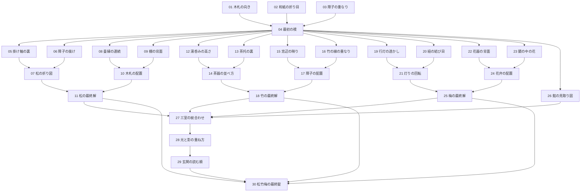

# 30段階の謎解き設計案 — 松竹梅を最後に集約

2026-10-21 改訂。**館と追加謎は未実装。公開v1.2.0は一部屋の操作試作。**

松・竹・梅の最終解は、各主要部屋の謎を解いて得る。途中の箪笥で三つとも使い切る旧案を変更し、玄関の最後の錠へ持ち帰る。数字の値は館版の試作で決める。現行試作の315を館版の確定解とはしない。

全30段階は、導入4・松の間7・竹の間7・梅の間7・終盤5。移動やアイテムを拾うだけの動作は数えない。30種類の新しい暗号規則を覚えさせず、向き・重なり・対応・数の読み方を応用する。完成版30〜45分は仮の目標で、試遊で調整する。

## 依存図

## 場所と前提

| 番号 | 場所 | 謎 | 前提 |
|---|---|---|---|
| 01 | 静寂の間 | 木札の向き | 探索開始 |
| 02 | 静寂の間 | 和紙の折り目 | 探索開始 |
| 03 | 静寂の間 | 障子の重なり | 探索開始 |
| 04 | 静寂の間 | 最初の襖 | 01・02・03 |
| 05 | 松の間 | 掛け軸の裏 | 04 |
| 06 | 松の間 | 障子の抜け | 04 |
| 07 | 松の間 | 松の折り図 | 05・06 |
| 08 | 松の間 | 畳縁の連続 | 04 |
| 09 | 松の間 | 棚の背面 | 04 |
| 10 | 松の間 | 木札の配置 | 08・09 |
| 11 | 松の間 | 松の最終解 | 07・10 |
| 12 | 竹の間 | 湯呑みの高さ | 04 |
| 13 | 竹の間 | 茶托の裏 | 04 |
| 14 | 竹の間 | 茶器の並べ方 | 12・13 |
| 15 | 竹の間 | 窓辺の映り | 04 |
| 16 | 竹の間 | 竹の線の重なり | 04 |
| 17 | 竹の間 | 障子の配置 | 15・16 |
| 18 | 竹の間 | 竹の最終解 | 14・17 |
| 19 | 梅の間 | 行灯の透かし | 04 |
| 20 | 梅の間 | 紐の結び目 | 04 |
| 21 | 梅の間 | 灯りの回転 | 19・20 |
| 22 | 梅の間 | 花器の背面 | 04 |
| 23 | 梅の間 | 鏡の中の花 | 04 |
| 24 | 梅の間 | 花弁の配置 | 22・23 |
| 25 | 梅の間 | 梅の最終解 | 21・24 |
| 26 | 廊下・大広間 | 館の見取り図 | 04 |
| 27 | 廊下・大広間 | 三室の紋合わせ | 11・18・25・26 |
| 28 | 廊下・大広間 | 光と影の重ね方 | 27 |
| 29 | 玄関 | 玄関の読む順 | 28 |
| 30 | 玄関 | 松竹梅の最終錠 | 11・18・25・29 |

## 一部屋を使う設計

各主要部屋に「二つの情報→仕掛け」「別の二つ→別の仕掛け」「二つの結果→その部屋の最終解」を置く。正面に全情報を並べず、背面・隅・家具の裏側に観察先を分散する。移動や向きの変化に意味を持たせる。

松は紙と木の方向、竹は茶器と直線の重なり、梅は花と透かしの関係を軸にする。例えば表の模様と裏の切り欠きが対応する、反対側から見た線が一つの図になる、といった推理を使う。小さなクリック箇所を隠すだけにしない。

三つの主要部屋は順不同で探索できる。最終解は自動で図に記録し、数字の暗記や長い再移動を要求しない。ヒントは各枝の状態から、観察先→関係→操作の順に出す。

終盤27〜29が同じ情報の再入力になれば統合する。30という数より、発見と納得を優先する。最初に制作するのは導入と隣室一枝であり、全30段階を完成扱いにしない。
